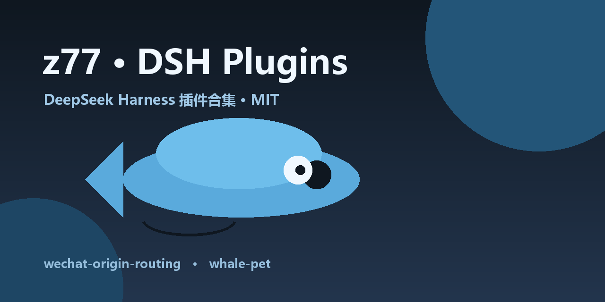

# z77 的 DSH 插件合集

我在用的几个 DeepSeek Harness（DSH）插件，改过的按 MIT 协议开源，别人也能直接用。

> 署名：**z77 修改版 / 原创版**。每个插件目录里都有 `LICENSE` 与修改说明。

## 插件列表

| 目录 | 插件 | 说明 |
|---|---|---|
| `plugins/wechat-origin-routing/` | **微信渠道（z77 修改版）** | 基于 [dsh-wechat-plugin 0.47.0](https://github.com/xcisxc29/dsh-wechat)（MIT）修改：按 **sessionId + turn** 粒度隔离来源；微信发起的纯微信回合才推送微信/在微信审批，桌面或混合回合桌面兜底；修复带工具调用、多 step 长回合的最终答复丢失。 |
| `plugins/whale-pet/` | **蓝色大肥鱼跳出窗口**（原创） | 把 DSH 的余额小鲸鱼挂件放到桌面：透明置顶小窗，可拖动，单击弹余额气泡、右键菜单。原生 Win32 实现，附源码。 |



## 安装（本机已有 DSH 桌面端）

1. 克隆仓库：
   ```bash
   git clone https://github.com/famdic1903-hash/dsh-hub.git
   ```
2. 在 DSH 里安装对应插件目录（绝对路径）：
   ```text
   plugin_manager install_bundle → target: <仓库路径>/plugins/<插件目录>
   ```
   或使用命令行：
   ```bash
   dsh plugin --profile desktop add <仓库路径>/plugins/<插件目录> -w
   ```
3. 安装后完全退出并重新打开 DSH。

> 微信插件是第三方项目的修改版，使用前请阅读其 `MODIFICATIONS.md` 与上游 `LICENSE`。

## 版本管理

- 仓库版本：语义化 `vMAJOR.MINOR.PATCH`，见 [CHANGELOG.md](CHANGELOG.md) 与 Releases；
- 插件版本：各插件 `package.json` 内独立版本号；微信修改版沿用上游基础版本 + `-z77.N` 后缀（当前 `0.47.0-z77.10`）；
- 安装固定版本：建议 clone 后 `git checkout <tag>` 再安装，避免主线改动影响稳定性。

## 许可证

- 本仓库中由 z77 编写/修改的部分：MIT（见根目录 `LICENSE`）。
- `plugins/wechat-origin-routing/` 来自 MIT 协议的 `dsh-wechat-plugin`，原版权归 dsh-wechat contributors，原 `LICENSE` 保留在该目录；修改部分版权归 z77。
- 各插件目录内如有独立 `LICENSE`，以该目录为准。
